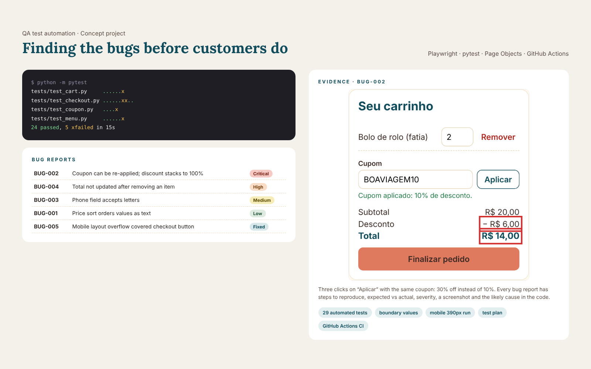

# QA test automation: café pickup ordering (Playwright + pytest)

> **Concept project.** The system under test is a staging build of an online pickup-ordering page for the fictional Quebra-Mar Café & Padaria. The build contains **four seeded defects**, so the suite and bug reports have real problems to find. A fifth, unplanned bug was caught by the mobile test during development and fixed (BUG-005).



## What's here
| Path | Contents |
|---|---|
| `app/` | The application under test (HTML/CSS/JS, staging v0.9) |
| `tests/` | 29 automated UI tests in pytest + Playwright |
| `tests/pages/` | Page Objects (`ShopPage`, `CheckoutPage`): selectors and user actions live here, not in the tests |
| `docs/test-plan.md` | Scope, approach, test cases, results and release recommendation |
| `docs/bug-reports.md` | 5 bug reports with steps, expected vs actual, severity, evidence and likely cause |
| `docs/evidence/` | Screenshots reproducing each bug (generated by `scripts/capture_evidence.py`) |
| `reports/report.html` | HTML report from the latest run |
| `.github/workflows/tests.yml` | Runs the suite on GitHub Actions for every push and uploads the report |

## Run it
```bash
pip install -r requirements.txt
python -m playwright install chromium
python -m pytest                      # 24 passed, 5 xfailed
python -m pytest --headed --slowmo 300   # watch the browser
python -m pytest --runxfail           # "bug-hunting mode": known bugs show as failures
python -m pytest --html=reports/report.html --self-contained-html
```
The tests start a small local web server for `app/` automatically, so nothing else is needed.

## How known bugs are handled
Each open bug keeps its test in the suite, marked `@pytest.mark.xfail(strict=True, reason="BUG-00X: …")`:
- The run stays **green** while the bug is open, so CI isn't blocked by issues already reported.
- When a developer fixes the bug, the test **passes unexpectedly**, and because the marker is `strict`, the run **fails**. That's the signal to remove the marker, and the test then guards against the bug coming back.

## Coverage
Menu (listing, category filter, sorting) · cart (add, quantities with boundary values, remove, badge) · coupons (valid, case and spaces, invalid, stacking) · checkout (required fields, phone validation, pickup-time boundaries 06:30 / 07:00 / 18:59 / 19:00 / 22:15) · confirmation (order number format, total, pickup time) · a full order on a 390 px phone screen.

## Bugs found
| ID | Severity | Summary |
|---|---|---|
| BUG-002 | Critical | Coupon can be re-applied and the discount stacks (10 clicks = free order) |
| BUG-004 | High | Total and badge don't update after removing an item |
| BUG-003 | Medium | Phone field accepts letters |
| BUG-001 | Low | Price sort compares text, so R$ 11,00 comes before R$ 4,00 |
| BUG-005 | High · fixed | Mobile layout overflow made the checkout button hard to tap |

Full reports: [docs/bug-reports.md](docs/bug-reports.md)

## Why Playwright
Playwright waits automatically for elements to be ready, which removes most flaky `sleep()` calls. It also runs headless in CI with one install command and emulates phones out of the box. The same Page Object structure carries over to Selenium WebDriver if a client's stack requires it.
