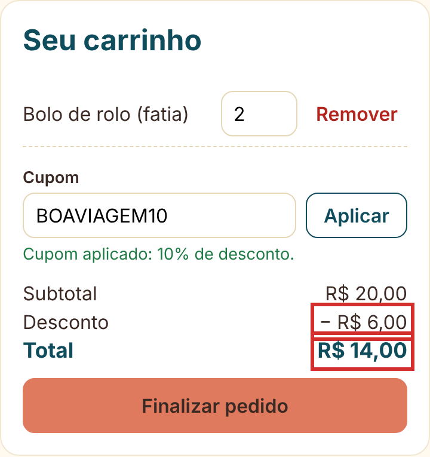
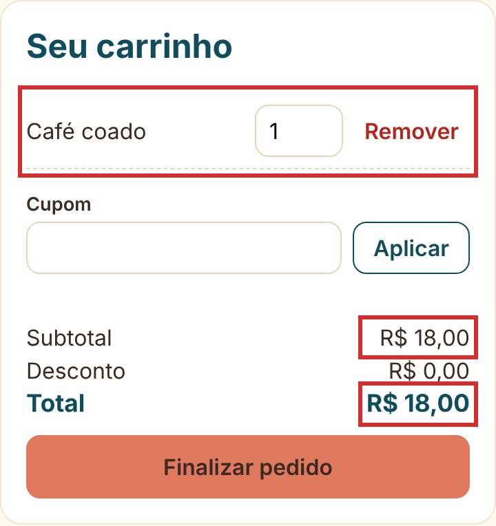
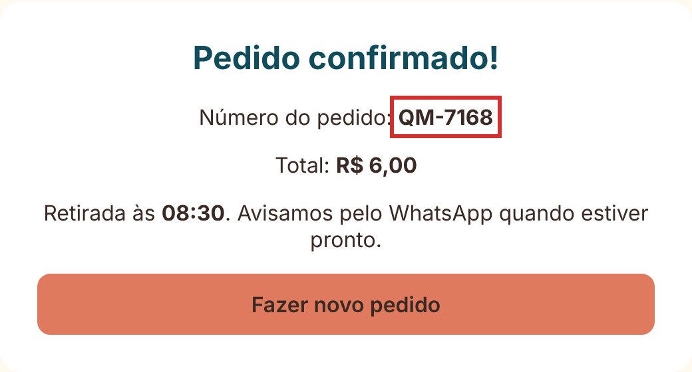
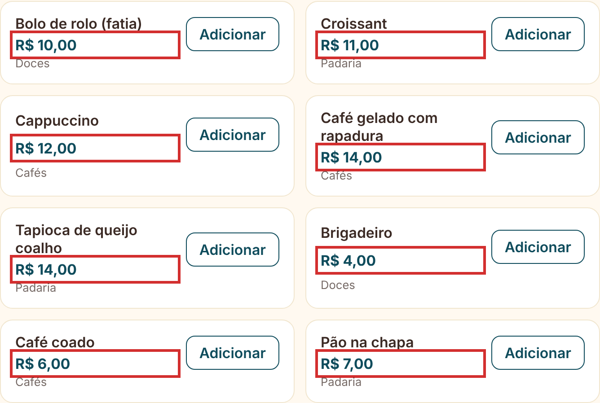

# Bug reports: Quebra-Mar pickup ordering (staging v0.9)

**Environment:** Chromium 153 (Playwright), Linux · desktop 1280×820 and mobile 390×844 · local build in `app/`
**Tested by:** Gian Carlo Barbarini · **Date:** Nov 2026

| ID | Title | Severity | Priority | Status | Automated test |
|---|---|---|---|---|---|
| BUG-002 | Coupon can be applied repeatedly and the discount stacks | Critical | P1 | Open | `test_coupon.py::test_same_coupon_cannot_be_applied_twice` |
| BUG-004 | Totals and cart badge are not updated after removing an item | High | P1 | Open | `test_cart.py::test_removing_an_item_updates_total_and_badge` |
| BUG-003 | Phone field accepts letters | Medium | P2 | Open | `test_checkout.py::test_phone_with_letters_is_rejected` |
| BUG-001 | "Price: low to high" sort orders prices as text | Low | P3 | Open | `test_menu.py::test_sort_by_price_low_to_high` |
| BUG-005 | Page wider than phone screen; checkout button partly covered | High | P1 | Fixed | `test_checkout.py::test_full_order_on_a_phone_screen` |

Severity reflects the impact on the business: money lost and wrong prices shown to customers rank highest.

---

## BUG-002: Coupon can be applied repeatedly and the discount stacks
**Severity:** Critical (direct revenue loss; a customer can reach 100% off) · **Priority:** P1

**Steps to reproduce**
1. Add 2 × "Bolo de rolo (fatia)" to the cart (subtotal R$ 20,00).
2. Type `BOAVIAGEM10` in the coupon field and click **Aplicar**.
3. Click **Aplicar** two more times.

**Expected:** The discount stays at 10% (R$ 2,00) and a message says the coupon is already applied. Total: R$ 18,00.
**Actual:** Each click adds another 10%. After 3 clicks the discount is R$ 6,00 (30%) and the total is R$ 14,00. Ten clicks make the order free.

**Evidence:** 
**Likely cause:** `applyCoupon()` adds the rate to `discountRate` without checking whether a coupon is already active.

---

## BUG-004: Totals and cart badge are not updated after removing an item
**Severity:** High (the customer sees a wrong total) · **Priority:** P1

**Steps to reproduce**
1. Add "Café coado" (R$ 6,00) and "Cappuccino" (R$ 12,00).
2. Click **Remover** next to Cappuccino.

**Expected:** Subtotal and total change to R$ 6,00 and the cart badge shows 1.
**Actual:** The item disappears, but subtotal and total still show R$ 18,00 and the badge still shows 2. The correct value only appears after another action, such as changing a quantity.

**Evidence:** 
**Likely cause:** `removeFromCart()` re-renders the list but never calls `updateTotals()`.

---

## BUG-003: Phone field accepts letters
**Severity:** Medium (the café can't confirm the order on WhatsApp) · **Priority:** P2

**Steps to reproduce**
1. Add any item and click **Finalizar pedido**.
2. Fill Name `Ana Souza`, Phone `abcdefghijk`, Pickup `08:30`.
3. Click **Confirmar pedido**.

**Expected:** Error "Telefone inválido." The phone must have 10 or 11 digits; spaces, parentheses and dashes are fine.
**Actual:** The order is confirmed with an unusable phone number.

**Evidence:** 
**Likely cause:** `validatePhone()` only checks that the text is at least 10 characters long.

---

## BUG-001: "Price: low to high" sort orders prices as text
**Severity:** Low (cosmetic; no money impact) · **Priority:** P3

**Steps to reproduce**
1. Open the menu.
2. Select **Ordenar → Preço (menor → maior)**.

**Expected:** R$ 4,00 · R$ 6,00 · R$ 7,00 · R$ 10,00 · R$ 11,00 · R$ 12,00 · R$ 14,00 · R$ 14,00
**Actual:** R$ 10,00 · R$ 11,00 · R$ 12,00 · R$ 14,00 · R$ 14,00 · R$ 4,00 · R$ 6,00 · R$ 7,00

**Evidence:** 
**Likely cause:** The sort compares the formatted strings ("R$ 10,00" < "R$ 4,00" alphabetically) instead of the numeric price.

---

## BUG-005: Page wider than the phone screen; checkout button partly covered (fixed)
**Severity:** High (mobile users could not reliably tap "Finalizar pedido") · **Status:** Fixed

This one wasn't planted. The mobile end-to-end test found it while the suite was being written.

**Found by:** `test_full_order_on_a_phone_screen` timed out because another element covered the checkout button.
**Root cause:** On a 390 px screen the two filter dropdowns couldn't wrap, so the menu column grew to 425 px. The page became wider than the screen, the browser zoomed it out, and the cart overlapped the button.
**Fix:** The filters now wrap (`flex-wrap: wrap`) and the grid column can shrink (`minmax(0, 1fr)`). A similar overflow on the coupon field (`min-width: 0`) was fixed at the same time. The mobile test now passes and protects against regressions.
